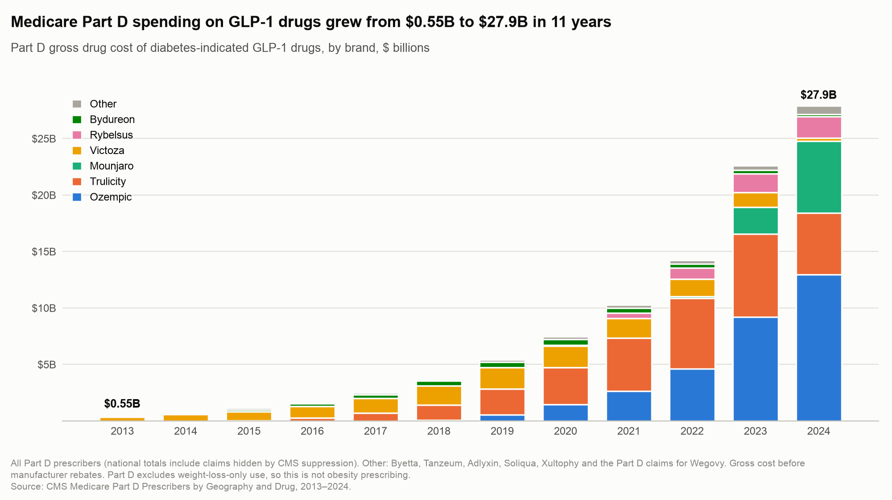
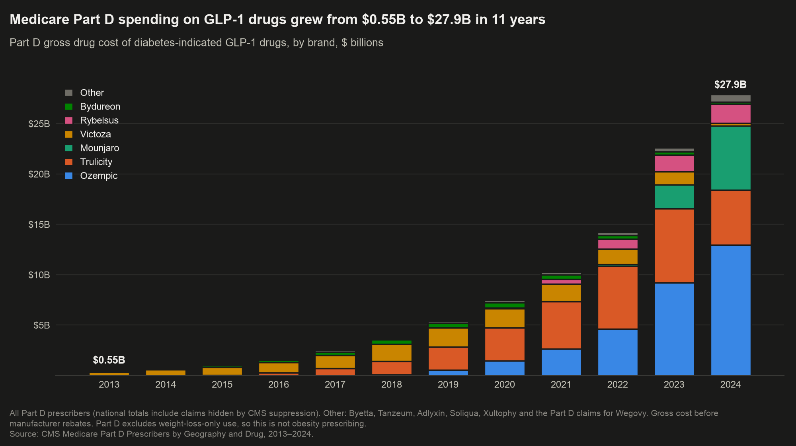
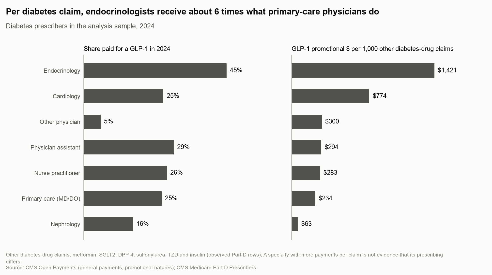
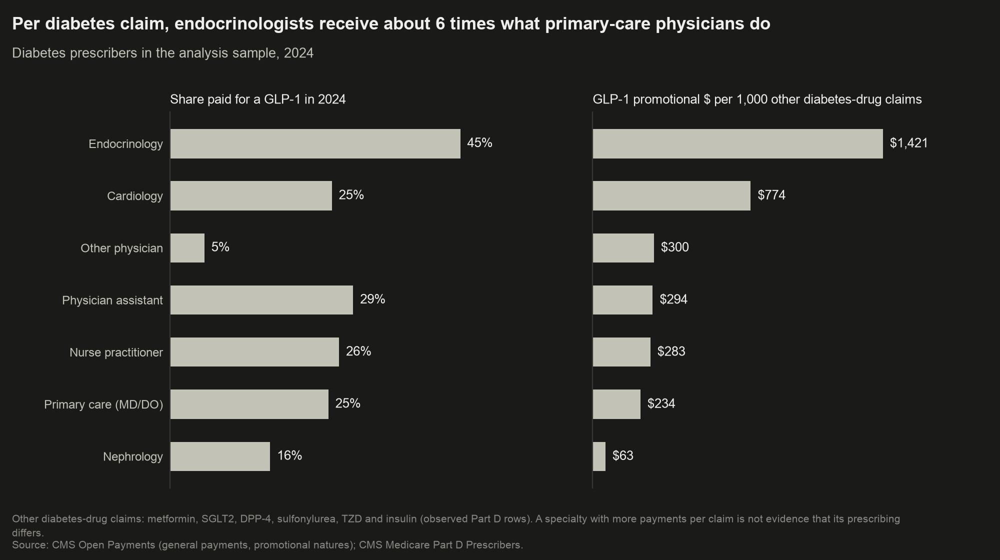

::: {#fig-hero .column-page-right}
{.light-content fig-alt=""}

{.dark-content fig-alt=""}

Change in the paid brand's share of the doctor's GLP-1 claims around the first payment, against not-yet-paid doctors. Data: [switching.json](qa/switching.json).
:::

::: {.callout-note appearance="simple" icon="false"}
## What we found

- **After a drug maker's first payment, its GLP-1 brand gains a few percentage points of the doctor's GLP-1 prescribing.** Compared with similar doctors not yet paid, the paid brand's share rises by  points for Trulicity,  for Ozempic and  for Mounjaro, mostly at the expense of direct competitors.
- **Doctors whose practices were already growing are the ones companies reach.** Paid doctors become more likely to prescribe the paid brand regularly ( /  /  percentage points for Trulicity, Victoza and Ozempic), but their statin prescribing, which no GLP-1 payment should touch, rises too ( /  / ).
- **The money is concentrated.** Since 2013, drug makers have paid $ million in promotional payments naming a GLP-1 to about ,000 prescribers; the top 1% received % of it, % of that as speaker fees.
:::

::: {.callout-warning appearance="simple" icon="false"}
## What this doesn't mean

- **It does not show that payments caused prescribing.** Companies choose whom to pay, and they call on doctors when a brand gains formulary or guideline position. The share shift is *consistent with* payments influencing brand choice, but not proof.
- **It is not evidence of inappropriate prescribing.** GLP-1s are effective diabetes drugs; prescribing more of them, or of one brand, can be good care.
- **It says nothing about obesity prescribing** (Medicare Part D excludes weight-loss-only use) **or about any individual doctor.** No prescriber is named, mapped or ranked anywhere in this project.
:::

## The question

Between 2013 and 2024, Medicare Part D spending on GLP-1 drugs grew from $ billion to $ billion a year. Over the same years the companies that make them, chiefly Novo Nordisk and Eli Lilly, paid doctors for meals, talks, consulting and travel, and the federal Open Payments program published every payment.

Two decades of research find that doctors who take industry money prescribe more of the payer's drugs [@dejong2016; @yeh2016; @fleischman2016; @hadland2018; @mitchell2021]. Almost all of that work compares paid and unpaid doctors at one point in time, so it cannot tell influence from targeting: drug representatives visit the doctors who already prescribe, or are about to prescribe, the most. The one GLP-1 study so far is also a cross-sectional snapshot [@khunte2026].

This project asks a narrower, harder question: **when a doctor receives a first promotional payment for a specific GLP-1 brand, does their prescribing of *that brand* change afterwards, compared with similar doctors who have not yet been paid — and does it change in ways that targeting alone would not produce?**

::: {.column-page-right}
{.light-content fig-alt=""}
{.dark-content fig-alt=""}
:::

## The data

Everything here comes from public federal data.

- **CMS Open Payments**, the "Sunshine Act" database:  million general payments that name a GLP-1 brand, 2013–2025. We keep the promotional ones (meals, speaker and consulting fees, travel, education, gifts) and drop royalties, research grants and acquisitions. A payment naming several drugs is split equally between them for dollar totals.
- **Medicare Part D Prescribers by Provider and Drug**, 2013–2024: each prescriber's yearly claims for each drug, linked to Open Payments by National Provider Identifier. The link is near-complete: % of physician payment records in 2013 and at least % from 2015 on.
- **The analysis panel** follows  prescribers who treat diabetes regularly (out of  Part D prescribers), each GLP-1 brand and each year. The main event study uses the  physicians among them, because payments to nurse practitioners and physician assistants were not reported before 2021.

Two features of the data shape every result:

1. **Medicare hides small counts.** A prescriber-drug row with fewer than 11 claims in a year is suppressed. A missing row means "0 to 10 claims", not zero. The main outcome is therefore *whether* a doctor wrote at least 11 claims of the brand that year, which is always observed; prescription volumes are estimated separately with bounds for the hidden cells.
2. **Almost every GLP-1 prescriber gets paid eventually.** % of GLP-1 fills in 2013, and % in 2024, came from prescribers who received a GLP-1 payment at some point. So the comparison group is mostly doctors **not paid yet**, not doctors never paid.

::: {.column-page-right}
{.light-content fig-alt=""}
{.dark-content fig-alt=""}
:::

## How we measured it, in plain English

**Before looking at any result, we wrote down the analysis and locked it.** The pre-registration ([PREREGISTRATION.md](https://github.com/johnpospisil/pharma-payments-glp1/blob/main/PREREGISTRATION.md)) fixed the outcome, the comparison, the estimator, the tests that could prove the finding wrong, and how each pattern of results would be described. Every later change is logged there as a dated deviation.

**The comparison.** For each brand, doctors enter the study in the year of their first promotional payment for it. Each one is compared with doctors in the same years who had not yet been paid for that brand, and who had a similar diabetes workload, overall Medicare volume, prior GLP-1 prescribing, specialty and region. The estimator, from @callaway2021 with the doubly robust adjustment of @santanna2020, is built for exactly this staggered timing; simpler two-way fixed-effects regressions can give badly wrong answers when timing varies [@goodmanbacon2021; @roth2023].

**The tests that could sink it.** If payments simply mark doctors who were already on the way up, three things should show:

- **a rising trend *before* the first payment** (checked with pre-period estimates and the sensitivity bounds of @rambachan2023);
- **the same "effect" on drugs the payment has nothing to do with**, here statins (a *negative-control outcome*, @lipsitch2010);
- **an effect that disappears when paid doctors are matched to unpaid doctors with the same prior trajectory** [coarsened exact matching, @iacus2012].

**Brand share.** The cleanest test asks how the paid brand's *share* of the doctor's own GLP-1 prescribing changes. A doctor whose practice is simply growing should prescribe more of every brand, so share cancels practice size out, in the spirit of @dejong2016.

**Who this describes.** Nearly all newly paid doctors were first reached through sponsored meals: % received under $100 in their first payment year. The  doctors ever paid as GLP-1 speakers were mostly first paid before 2015, so they are outside the event study. The results describe doctors first reached by a lunch, not speakers.

## Result 1: the paid brand gains share

Among doctors who already prescribe GLP-1s (@fig-hero, top of page), the paid brand's share of their GLP-1 claims rises after the first payment and keeps rising for two to three years. Averaged over the four years from the payment year on, the gain is ** percentage points for Trulicity,  for Ozempic and  for Mounjaro** (measured from its 2022 launch).

For Trulicity and Mounjaro, the paid and comparison doctors' shares moved together beforehand (pre-trend test p =  and ). For Ozempic there was a mild upward drift before payment (p = ) that disappears with matching.

**The gain comes from direct competitors.** After a Trulicity payment, Victoza's share falls by  points; after an Ozempic payment, Trulicity's falls by ; after a Mounjaro payment, Lilly's own Trulicity falls by . For the established brands, % (Trulicity) and % (Ozempic) of the extra claims after payment come from switching between brands rather than from more GLP-1 prescribing overall.

::: {.column-page-right}
{.light-content fig-alt=""}
{.dark-content fig-alt=""}
:::

**Victoza is the exception.** Its share *falls* after a Victoza payment ( points). Those payments came while Novo Nordisk was moving the market from Victoza to its own newer Ozempic.

::: {.doesnt-box}
**How strong is this?** Under the linear estimators the share gain is precise and survives matching and adjustment for each doctor's starting brand mix. The pre-registered version models the share on a log-odds scale with matching. It gives similar sizes (, , ), but it is much less precise, and only Mounjaro's interval excludes zero on its own. Pooled across brands it is  points (Holm-adjusted p = ). Without matching, the log-odds version is close to zero. So the direction is consistent; the size depends on modelling choices, and the pooled test rests on matching.
:::

## Result 2: the volume increase mostly reflects who gets paid

The obvious headline would be that paid doctors become far more likely to prescribe the brand. They do: the probability of writing at least 11 claims of the paid brand in a year rises by ** points for Trulicity,  for Victoza and  for Ozempic** over the four years from the first payment, and matching on prior prescribing barely changes that ( /  / ).

But the pre-registered tests say this number cannot be read as the effect of a payment:

::: {#fig-statins .column-page-right}
{.light-content fig-alt=""}

{.dark-content fig-alt=""}

The paid brand and statins around the first payment. Data: [falsification.json](qa/falsification.json).
:::

- **Paid doctors were already rising before they were paid.** The pre-payment trend is steep and statistically clear for all three brands.
- **Their statin prescribing rises too**: by ,  and  points, with an even steeper rise beforehand. A GLP-1 lunch has no reason to change statin prescribing; a growing practice does. Paid doctors' total Medicare Part D claims grew % more than their comparison doctors'.
- **Matching does not remove it.** Matching on prior brand prescribing balances those variables (largest standardised difference ), but not total practice growth (standardised difference ). Matching on practice growth as well leaves the estimates almost unchanged ( /  / ), and the statin test still fails under it.

Under the pre-registered interpretation rules, this pattern is reported as **"explained at least partly by targeting of already-rising prescribers."** It is why the article leads with brand share, which a growing practice does not move.

## Result 3: bigger payments, bigger changes, different doctors

::: {.column-page-right}
{.light-content fig-alt=""}
{.dark-content fig-alt=""}
:::

Doctors who received $100 or more for the brand in their first payment year rose more than those who received less:  vs  points for Trulicity,  vs  for Ozempic. Doctors with four or more contacts in that year rose about twice as much as doctors with one ( vs ;  vs ). Pooled, the $100 gap is  points.

**This is a gradient, not a dose-response.** Companies give more to doctors they expect more from, so the higher-paid groups differ in ways the comparison cannot fully remove.

**Speaker fees vs meals.** Doctors first paid with a speaker or consulting fee rose  points more than meal-only doctors, but there are only  such doctors per brand, and the difference is not statistically clear after adjustment for multiple tests (Holm p = ). The study cannot say whether speaker fees matter more than meals.

## Where the money goes

::: {.column-page-right}
{.light-content fig-alt=""}
{.dark-content fig-alt=""}
:::

GLP-1 promotional money is extremely concentrated. Of  prescribers paid for a GLP-1 through 2024, the top 1% received % of the dollars and the top 10% received % (Gini ); the median paid prescriber received $ over twelve years. Speaker and consulting fees are % of all GLP-1 promotional dollars, paid to  speakers in all; meals are %.

::: {.column-page-right}
{.light-content fig-alt=""}
{.dark-content fig-alt=""}
:::

Per Medicare Part D enrollee with diabetes, GLP-1 promotional payments in 2024 ranged from $ () to $ (), against $ nationally.  are left blank: in each, one prescriber received more than half of the state's GLP-1 promotional dollars, so the state's figure would describe one person.

::: {.column-page-right}
{.light-content fig-alt=""}
{.dark-content fig-alt=""}
:::

Relative to diabetes workload, endocrinologists receive about  times as much per claim as primary-care physicians ($ vs $ per 1,000 other diabetes-drug claims in 2024).

## Who responds

The pre-registered secondary questions, each adjusted together for multiple testing [@holm1979]:

::: {.table-scroll}
| Question | Estimate | Holm-adjusted p | Reading |
|---|---|---|---|
| Speaker or consulting fee vs meals only |  pp |  | Not supported: too few fee recipients |
| Specialists vs primary care |  pp |  | Not supported |
| First-year $100 or more vs under $100 |  pp |  | Gradient; higher-paid doctors are more selected |
| Paid brand's share (log-odds, matched) |  pp |  | Supported, pooled; rests on matching |
| 30-day fills (most conservative suppression bound) | % |  | Supported; size depends on how hidden cells are bounded (% to %) |
| Nurse practitioners and physician assistants |  pp |  | Supported, with the same targeting caveat |

: Secondary hypotheses. Data: [secondary_family.csv](qa/secondary_family.csv). {tbl-colwidths="[34,14,14,38]"}
:::

**Region and setting.** The increase is larger in the South than in every other region, for every brand (by  points), and larger in rural than urban practices for Trulicity () and Victoza (). These subgroup estimates inherit the targeting caveat above: they may reflect where practices were growing, or regional formularies, rather than who responds to payments.

**Specialty.** There is no consistent specialist advantage. Victoza's increase is larger among endocrinologists ( points relative to primary care), while Ozempic's is smaller among endocrinologists () and cardiologists ().

**Nurse practitioners and physician assistants**, whose payments are reported only from 2021, show increases of  (Trulicity) and  (Ozempic) points; Victoza has only  newly paid NPs and PAs. There is no matched or negative-control version of this estimate.

## Falsification and robustness

::: {.table-scroll}
| Test | What would sink the finding | Result |
|---|---|---|
| Pre-payment trend, ≥ 11 claims | Paid doctors already rising | **Fails**: steep rising trend for all three brands |
| Pre-payment trend, brand share | Share already rising | **Passes** for Trulicity (p = ) and Mounjaro (p = ); mild drift for Ozempic |
| Statins (negative-control outcome) | Statins rise too | **Fails** for all three:  /  /  pp |
| Anticoagulant payments (negative-control exposure) | Unrelated payments predict GLP-1 growth as strongly | **Passes**, but still % of the GLP-1 association |
| Inhaled-respiratory payments (second negative-control exposure) | Same | **Fails** (%); AstraZeneca and GSK also sell GLP-1s |
| Fake payment dates one or two years early | "Effects" before the real payment | **Passes** (at most  pp) |
| Ozempic payment → Trulicity prescribing (placebo brand) | Competitor rises too | **Fails** in levels ( pp), but Trulicity's *share* falls |
| HonestDiD sensitivity | Small violations of parallel trends erase it | Survives violations up to × / × / × the largest pre-period deviation |
|  alternative specifications | Effect depends on choices | Stays positive and above the 2-point threshold of interest in all:  /  /  pp |

: Falsification and robustness for Trulicity / Victoza / Ozempic. Data: [falsification.csv](qa/falsification.csv), [sensitivity.csv](qa/sensitivity.csv). {tbl-colwidths="[30,30,40]"}
:::

The failures all point the same way: paid doctors run larger and faster-growing practices. They undermine the volume result, which is why it is reported as targeting, and they leave the brand-share result standing, because a growing practice raises every brand together.

## Limitations

- **Targeting is not ruled out, only partly removed.** Matching balances prior brand prescribing but not overall practice growth, and the statin test fails even when matched on growth. Brand share removes practice size, but representatives may also visit when a brand wins a formulary or guideline change, which would raise its share without the payment doing anything.
- **The share result is modest and model-dependent.** It is precise under the linear estimators but imprecise under the pre-registered log-odds form, where only Mounjaro is clear on its own.
- **Annual data blur timing.** Payments arrive during the year, so the payment year is partly before and partly after.
- **Suppression.** Medicare hides prescriber-drug rows under 11 claims. The binary outcome is fully observed, but prescription volumes depend on how hidden cells are bounded.
- **Who is studied.** Medicare Part D only (not commercial insurance or Medicaid); physicians first reached mostly by sponsored meals; nurse practitioners and physician assistants only from 2021.
- **Spillovers.** Payments to one doctor may change colleagues' prescribing [@agha2022; @hyman2025]. Comparison doctors in practices where nobody was paid give *larger* estimates, so spillovers would bias the main estimate down, not up.

## Ethics: why no individual doctors appear

Open Payments names every recipient, and it would be easy to publish a league table. This project deliberately does not. A payment is legal, and a doctor who prescribes a paid brand may be prescribing well; a ranking would invite conclusions about individuals that aggregate data cannot support. Every published figure and table aggregates at least 11 prescribers per cell. Geographic cells are also withheld when one prescriber received more than half of the dollars, so that no state or specialty figure describes one person. Code uses prescriber identifiers internally; nothing released contains them.

## Reproducibility

All data are public. The pipeline (Python 3.12, DuckDB; R only for cross-checking the estimators) rebuilds every number and figure from the raw federal files with one command, `make all`, in about two hours. Two independent rebuilds produce identical results. Every number in this article is read from the pipeline's QA outputs, never typed by hand, and a test fails if one is. Code, pre-registration, deviations and the QA report: [github.com/johnpospisil/pharma-payments-glp1](https://github.com/johnpospisil/pharma-payments-glp1).

**What is new here.** Earlier work, including the closest design [@carey2021], established that payments and prescribing go together, but mostly from cross-sectional snapshots of older drugs. This project follows every Medicare GLP-1 prescriber brand by brand over twelve years, uses estimators built for staggered timing, tests brand switching directly, and reports the negative controls that cut against its own headline.

## References

::: {#refs}
:::
