::: {#fig-hero .column-page-right}
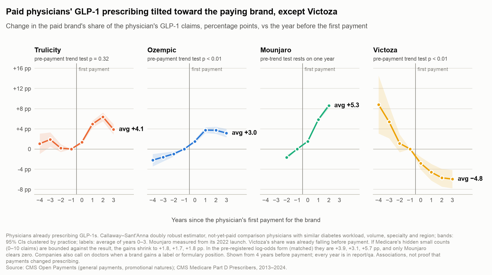{.light-content .d-only fig-alt=""}
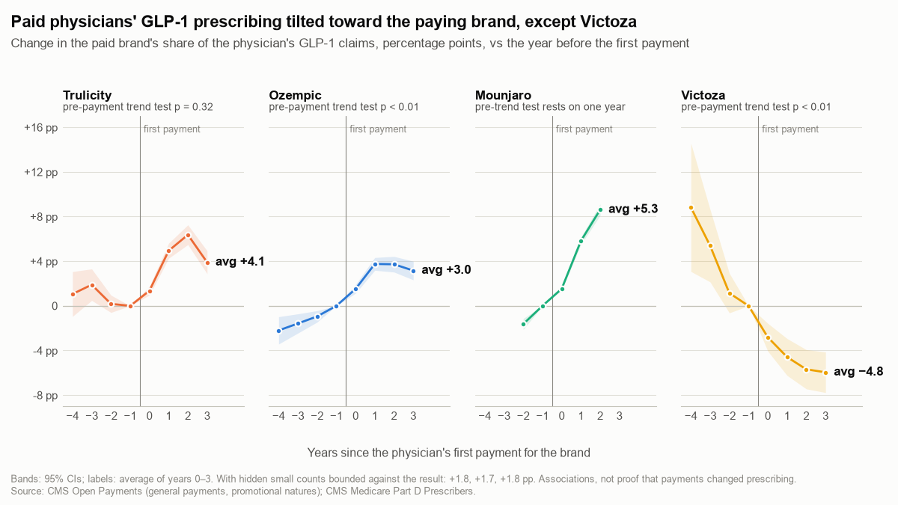{.light-content .m-only fig-alt=""}

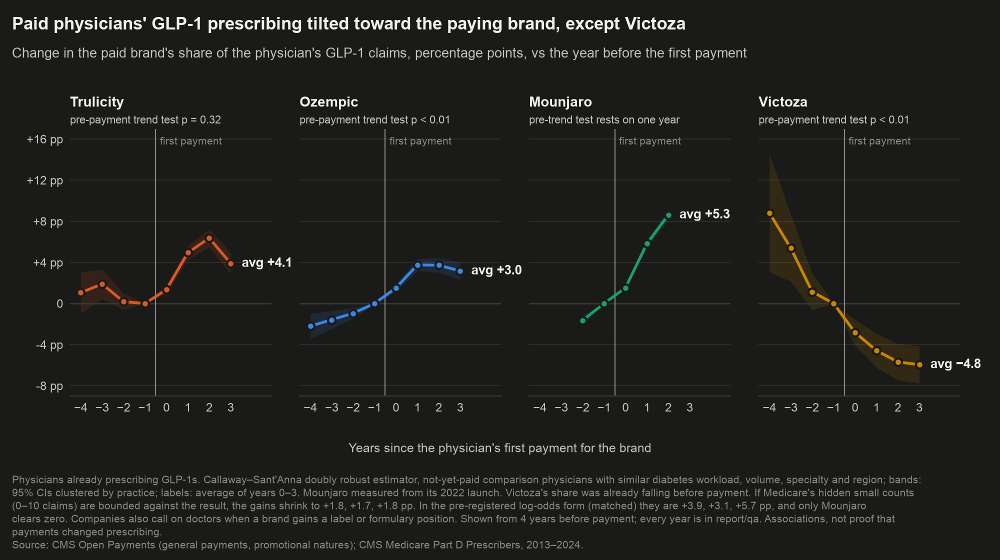{.dark-content .d-only fig-alt=""}
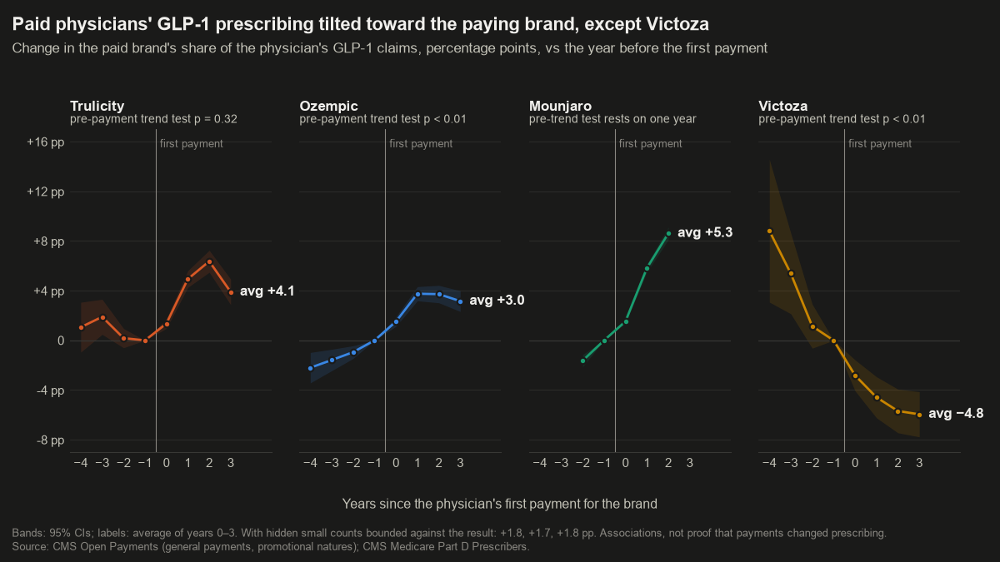{.dark-content .m-only fig-alt=""}

Change in the paid brand's share of the doctor's GLP-1 claims around the first payment, against not-yet-paid doctors. The size depends on how Medicare's hidden small counts are treated: from  points as measured to  points under the least favourable bound. Data: [switching.json](qa/switching.json), [review_p24.json](qa/review_p24.json).
:::

::: {.callout-note appearance="simple" icon="false"}
## What we found

- **Paid doctors' GLP-1 prescribing tilts a few points toward the paying brand.** Compared with similar doctors not yet paid, the paid brand's share of their GLP-1 claims rises by  percentage points for Trulicity,  for Ozempic and  for Mounjaro, mostly at the expense of direct competitors. The direction holds in every version we ran; the size does not. If the brand rows Medicare hides (0 to 10 claims) are bounded against the result, the gains shrink to  /  / , and in the pre-registered model only Mounjaro's gain is clearly above zero. Victoza's share falls.
- **Paid doctors' practices were already growing.** They become more likely to have 11 or more claims of the paid brand in a year ( /  /  percentage points for Trulicity, Victoza and Ozempic), but their statin prescribing, which a GLP-1 payment has no direct reason to change, rises too ( /  / ).
- **The money is concentrated.** From 2013 to 2025, drug makers paid $ million in promotional payments naming a GLP-1 (including $ million naming the obesity drugs Wegovy, Saxenda and Zepbound) to about ,000 prescribers. Through 2024, the top 1% of paid prescribers received % of the dollars, % of that as speaker fees; the median paid prescriber received $ over twelve years.
:::

::: {.callout-warning appearance="simple" icon="false"}
## What this doesn't mean

- **It does not show that payments caused prescribing.** Companies choose whom to pay, and representatives call when a brand has news: Ozempic and Trulicity both gained cardiovascular indications in early 2020, and shortages in 2022–2024 forced switches. The share shift is *consistent with* payments influencing brand choice, but it could also reflect paid doctors adopting newly launched brands sooner.
- **It is not a precise effect size.** The share gain is somewhere between about  and  points depending on choices the data cannot settle.
- **It is not evidence of inappropriate prescribing.** GLP-1s are effective diabetes drugs, several with proven cardiovascular benefit, and the brands are not interchangeable: they differ in dosing frequency, potency and evidence. Much of the switching runs in the direction guidelines favoured at the time.
- **It says nothing about obesity prescribing or about any individual doctor.** Part D cannot cover weight-loss-only prescriptions. Speaker and consulting fees pay for services, and concentration does not by itself imply wrongdoing. No prescriber is named, mapped or ranked anywhere in this project.
:::

## The question

Between 2013 and 2024, Medicare Part D gross spending on GLP-1 drugs (before manufacturer rebates) grew from $ billion to $ billion a year. Over the same years the companies that make them, chiefly Novo Nordisk and Eli Lilly, paid doctors for meals, talks, consulting and travel, and the federal Open Payments program published every payment.

Two decades of research find that doctors who take industry money prescribe more of the payer's drugs [@dejong2016; @yeh2016; @fleischman2016; @hadland2018; @mitchell2021]. Almost all of that work compares paid and unpaid doctors at one point in time, so it cannot tell influence from targeting: drug representatives visit the doctors who already prescribe, or are about to prescribe, the most. The one GLP-1 study so far is also a cross-sectional snapshot [@khunte2026].

This project asks a narrower, harder question: **when a doctor receives a first promotional payment for a specific GLP-1 brand, does their prescribing of *that brand* change afterwards, compared with similar doctors who have not yet been paid — and does it change in ways that targeting alone would not produce?**

## The data

Everything here comes from public federal data.

- **CMS Open Payments**, the "Sunshine Act" database:  million general payments that name a GLP-1 brand, 2013–2025. We keep the promotional ones (meals, speaker and consulting fees, travel, education, gifts) and drop royalties, research grants and acquisitions. A payment naming several drugs is split equally between them for dollar totals. Ozempic and Rybelsus are often promoted together, so "Ozempic" exposure largely means semaglutide promotion; counting any semaglutide brand as exposure gives a similar result ( points on the 11-claims outcome).
- **Medicare Part D Prescribers by Provider and Drug**, 2013–2024: each prescriber's yearly claims (pharmacy fills) for each drug, linked to Open Payments by National Provider Identifier. The link is near-complete: % of physician payment records in 2013 and at least % from 2015 on.
- **The analysis panel** follows  prescribers who treat diabetes regularly (out of  Part D prescribers), each GLP-1 brand and each year. The main event study uses the  physicians among them, because payments to nurse practitioners and physician assistants were not reported before 2021.

Two features of the data shape every result:

1. **Medicare hides small counts.** A prescriber-drug row with fewer than 11 claims in a year is suppressed. A missing row means "0 to 10 claims", not zero. The main outcome is therefore *whether* a doctor had at least 11 claims of the brand that year (roughly one patient refilling monthly, or a few on longer supplies), which is always observed; prescription volumes are estimated separately with bounds for the hidden cells.
2. **Most GLP-1 prescribing comes from doctors who are paid at some point.** % of GLP-1 fills in 2013, and % in 2024, came from prescribers who received a GLP-1 payment in some year. So the comparison group is mostly doctors **not paid yet**, not doctors never paid.

::: {.column-page-right}
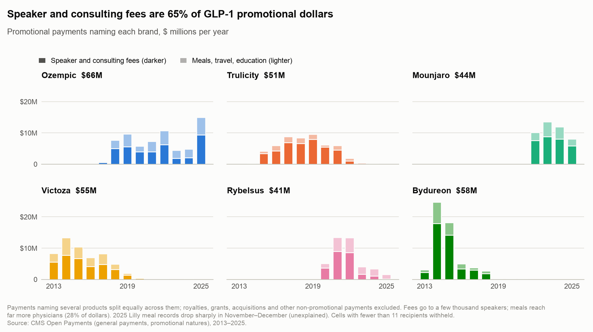{.light-content .d-only fig-alt=""}
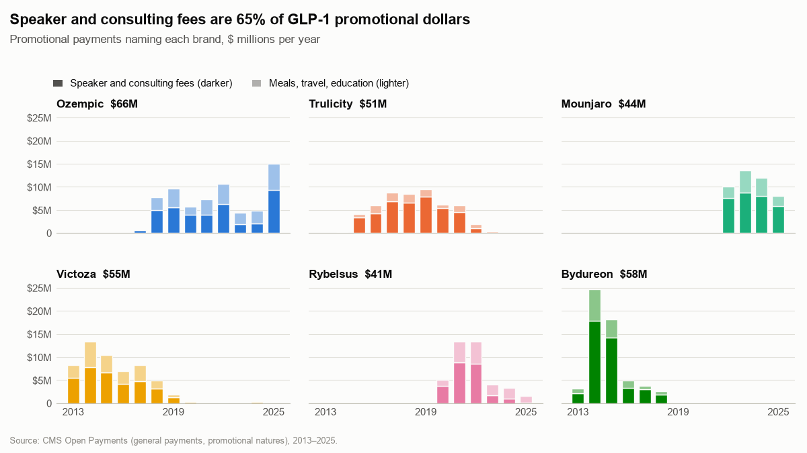{.light-content .m-only fig-alt=""}
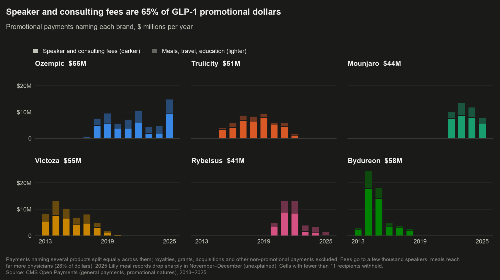{.dark-content .d-only fig-alt=""}
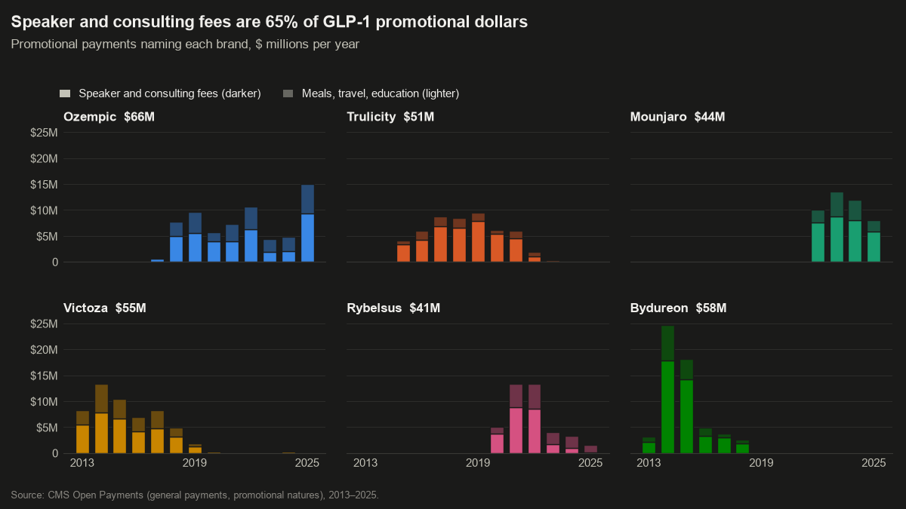{.dark-content .m-only fig-alt=""}
:::

## How we measured it, in plain English

**Before looking at any result, we wrote down the analysis and locked it.** The pre-registration ([PREREGISTRATION.md](https://github.com/johnpospisil/pharma-payments-glp1/blob/main/PREREGISTRATION.md)) fixed the outcome, the comparison, the estimator, the tests that could prove the finding wrong, and how each pattern of results would be described. Every later change is logged there as a dated deviation, and two matter for how you read this article. The pre-registered primary outcome (at least 11 claims) failed its own falsification tests; brand share was a pre-registered *secondary* question, and we chose to lead with it after seeing those failures. We also changed the implementation of the primary estimator after the first results; the first-reported estimates were  /  /  points.

**The comparison.** For each brand, doctors enter the study in the year of their first promotional payment for it. Each one is compared with doctors in the same years who had not yet been paid for that brand, and who had a similar diabetes workload, overall Medicare volume, prior GLP-1 prescribing, specialty and region. The estimator, from @callaway2021 with the doubly robust adjustment of @santanna2020, is built for exactly this staggered timing; simpler two-way fixed-effects regressions can give badly wrong answers when timing varies [@goodmanbacon2021; @roth2023]. All differences are in percentage points (pp): a share rising from one fifth to one quarter of a doctor's claims is a 5-point rise.

**The tests that could sink it.** If payments simply mark doctors who were already on the way up, three things should show:

- **a rising trend *before* the first payment** (checked with pre-period estimates and the sensitivity bounds of @rambachan2023);
- **the same "effect" on drugs the payment has nothing to do with**, here statins (a *negative-control outcome*, @lipsitch2010);
- **an effect that disappears when paid doctors are matched to unpaid doctors with the same prior trajectory** [coarsened exact matching, @iacus2012].

**Brand share.** The second line of evidence asks how the paid brand's *share* of the doctor's own GLP-1 prescribing changes. A doctor whose practice is simply growing should prescribe more of every brand, so share largely removes practice size, in the spirit of @dejong2016. It does not remove a tendency to adopt newly launched brands sooner, and it is measured on the claims Medicare shows, which matters (Result 1).

**Who this describes.** Nearly all newly paid doctors were first reached through sponsored meals: % received under $100 in their first payment year. The  doctors ever paid as GLP-1 speakers were mostly first paid before 2015, so they are outside the event study. The estimate covers entering a paid relationship with a manufacturer, usually starting with a lunch, including any later payments and visits; it does not describe speakers.

## Result 1: the paid brand gains a few points of share

Among doctors who already prescribe GLP-1s (@fig-hero, top of page), the paid brand's share of their GLP-1 claims rises after the first payment for one to two years and then levels off. Averaged over the payment year and the three years after, the gain is ** percentage points for Trulicity,  for Ozempic and  for Mounjaro** (measured from its 2022 launch, so its cohorts have at most two years of follow-up).

**How much of it is real depends on Medicare's hidden counts.** The share is computed from the brand rows Medicare shows. A paid brand that grows from, say, 8 claims (hidden, counted as zero) to 12 (shown) appears to jump from no share to a positive one, and crossing the 11-claim line is exactly what growing practices do (Result 2). Bounding the hidden rows against the result (the paid brand's hidden rows at their maximum, competitors' at zero) shrinks the gains to  /  /  points. That is still above zero, but below the 2-point threshold the pre-registration set as the smallest effect of interest. Two other checks leave the measured gains intact: counting 30-day fills instead of claims ( /  / ), and restricting to high-volume physicians, whose rows are rarely hidden ( /  / ).

**The pre-payment trends are mixed.** For Trulicity, the paid and comparison doctors' shares moved together beforehand (p = ), but the matched version rejects parallel trends (p = ). Ozempic drifted upward before payment (p = ), which matching removes. Mounjaro's pre-trend test (p = ) rests on about one year around its launch, so it says little. Victoza's share was already falling steeply (p ).

**The gain comes from direct competitors.** After a Trulicity payment, Victoza's share falls by  points; after an Ozempic payment, Trulicity's falls by ; after a Mounjaro payment, Lilly's own Trulicity falls by  (with a different adjustment, Ozempic loses more). For the established brands, % (Trulicity) and % (Ozempic) of the extra claims after payment come from switching between brands rather than from more GLP-1 prescribing overall. Switching from daily Victoza to weekly drugs, and toward more potent ones, is also what the evidence and guidelines of the time favoured.

::: {.column-page-right}
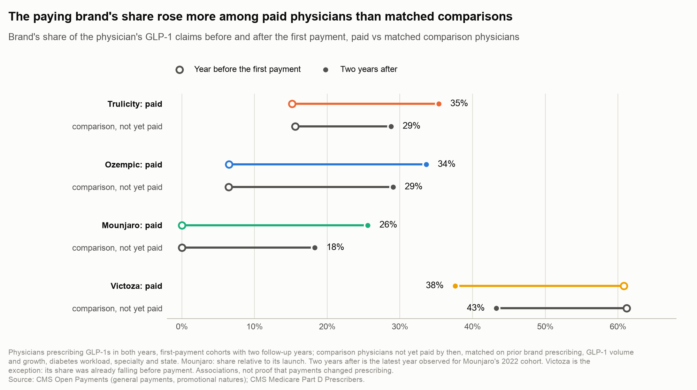{.light-content .d-only fig-alt=""}
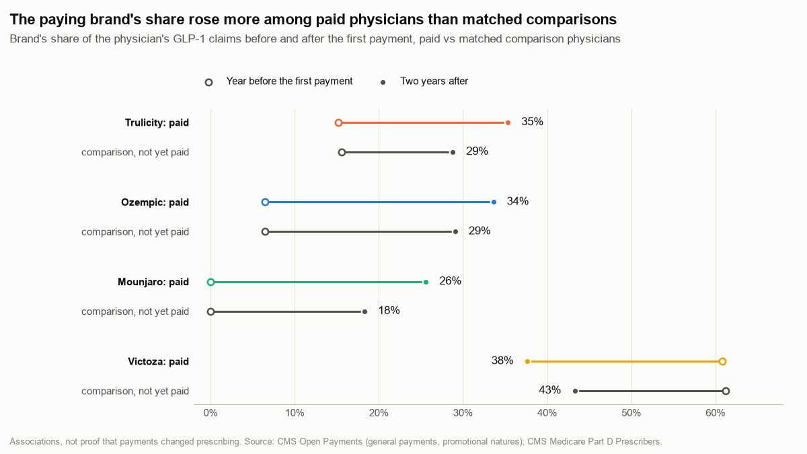{.light-content .m-only fig-alt=""}
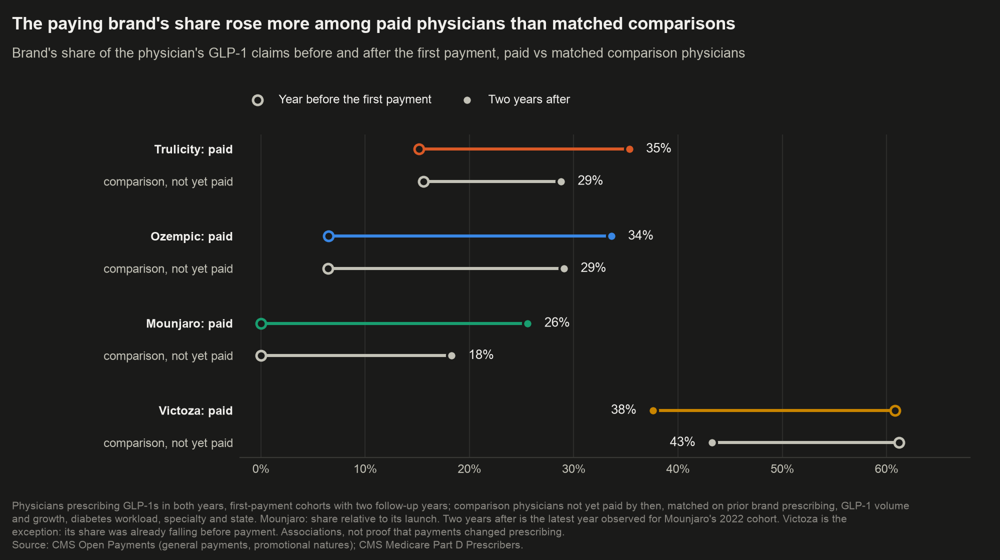{.dark-content .d-only fig-alt=""}
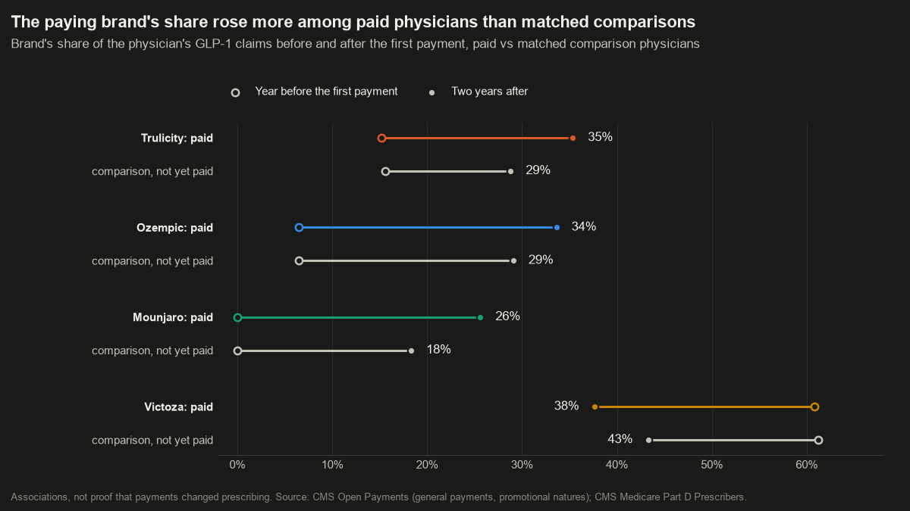{.dark-content .m-only fig-alt=""}
:::

**Victoza is the exception.** Its share *falls* after a Victoza payment ( points). One possible reason, not tested: Victoza payments came as once-weekly drugs (Trulicity, then Novo Nordisk's own Ozempic) displaced daily Victoza, and paid doctors started with a very high Victoza share that had room only to fall. Either way it cuts against a simple "payment wins share" reading.

::: {.doesnt-box}
**How solid is this?** The direction holds in every version we ran. The size does not. The method we committed to in advance models the share on a log-odds scale and gives similar numbers (, , ) but with wide margins of error: only Mounjaro is clearly above zero on its own. Combined across brands it is  points (Holm-adjusted p = ), and that combined result depends on comparing against closely matched doctors; without matching it is close to zero. Add the suppression bound above, and the honest summary is a modest, model-dependent shift of roughly  to  points.
:::

## Result 2: the volume increase reflects, at least partly, who gets paid

The obvious headline would be that paid doctors become far more likely to prescribe the brand. They do: the probability of having at least 11 claims of the paid brand in a year rises by ** points for Trulicity,  for Victoza and  for Ozempic** over the four years from the first payment, and matching on prior prescribing barely changes that ( /  / ).

But the pre-registered tests say this number cannot be read as the effect of a payment:

::: {#fig-statins .column-page-right}
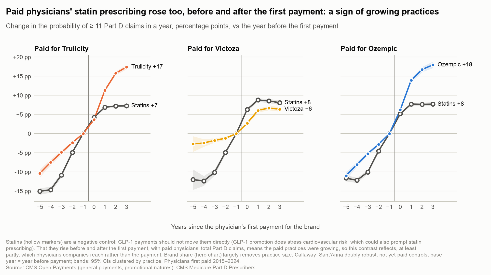{.light-content .d-only fig-alt=""}
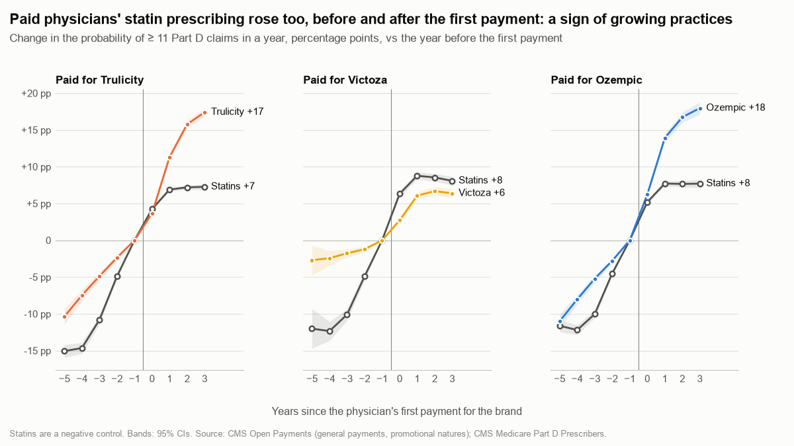{.light-content .m-only fig-alt=""}

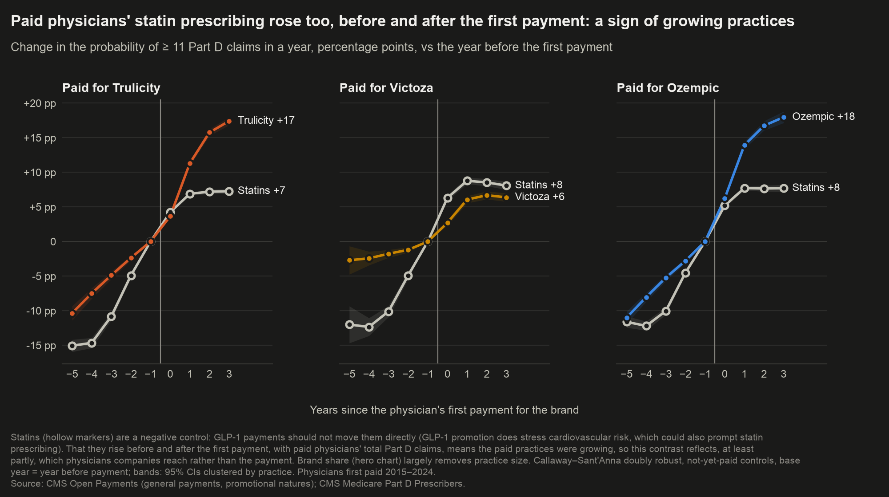{.dark-content .d-only fig-alt=""}
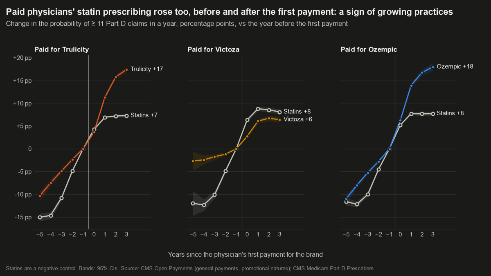{.dark-content .m-only fig-alt=""}

The paid brand and statins around the first payment. Data: [falsification.json](qa/falsification.json).
:::

- **Paid doctors were already rising before they were paid.** The pre-payment trend is steep and statistically clear for all three brands. If that trend had simply continued, the brand increase would be about half as large ( /  /  points), close to the statin rise below.
- **Their statin prescribing rises too**: by ,  and  points, with an even steeper rise beforehand. A GLP-1 payment has no direct reason to change statin prescribing (though GLP-1 promotion does stress cardiovascular risk, which could spill over); a growing practice does. Paid doctors' total Medicare Part D claims grew % more than their comparison doctors', and % more than matched comparison doctors'.
- **Matching does not remove it.** Matching on prior brand prescribing balances those variables, but not total practice growth. Matching on practice growth as well leaves the estimates almost unchanged ( /  / ), and the statin test still fails under it.

Under the pre-registered interpretation rules, this pattern is reported as **"explained at least partly by targeting of already-rising prescribers."**

## Result 3: bigger payments, bigger changes, different doctors

::: {.column-page-right}
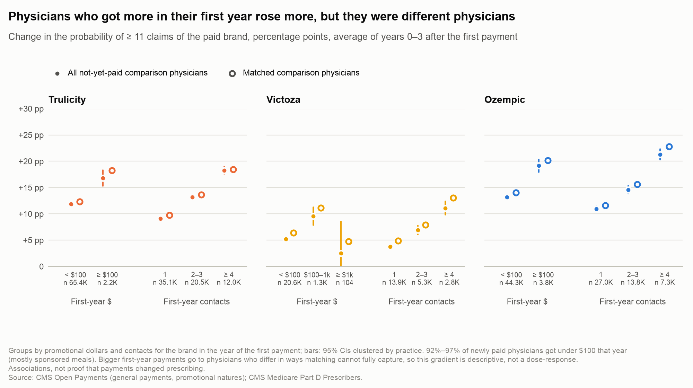{.light-content .d-only fig-alt=""}
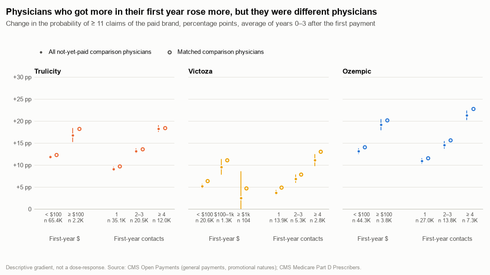{.light-content .m-only fig-alt=""}
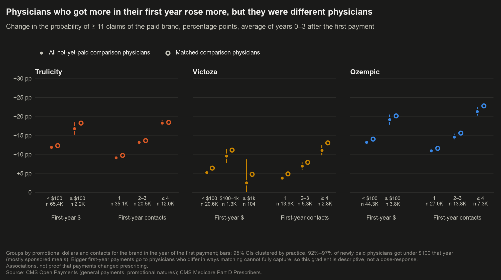{.dark-content .d-only fig-alt=""}
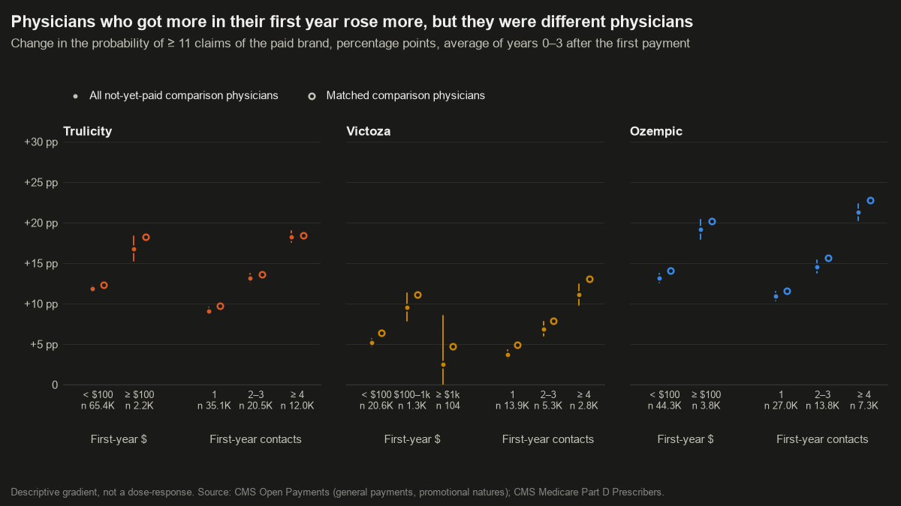{.dark-content .m-only fig-alt=""}
:::

Doctors who received $100 or more for the brand in their first payment year rose more than those who received less:  vs  points for Trulicity,  vs  for Ozempic. Doctors with four or more contacts in that year rose about twice as much as doctors with one ( vs ;  vs ). Pooled, the $100 gap is  points.

**This is a gradient, not a dose-response.** Companies give more to doctors they expect more from, so the higher-paid groups differ in ways the comparison cannot fully remove.

**Speaker fees vs meals.** Doctors first paid with a speaker or consulting fee rose  points more than meal-only doctors, but there are only  such doctors per brand, and the difference is not statistically clear after adjustment for multiple tests (Holm p = ). The study cannot say whether speaker fees matter more than meals.

## Where the money goes

::: {.column-page-right}
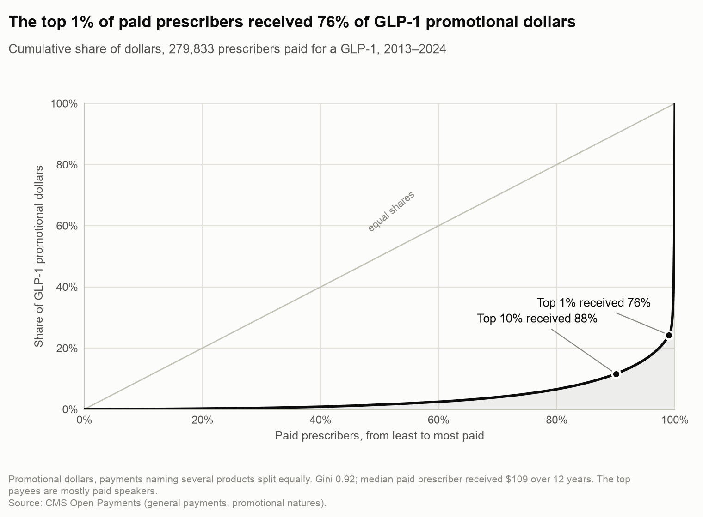{.light-content .d-only fig-alt=""}
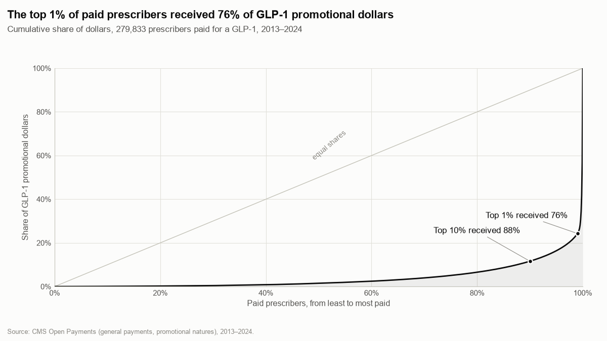{.light-content .m-only fig-alt=""}
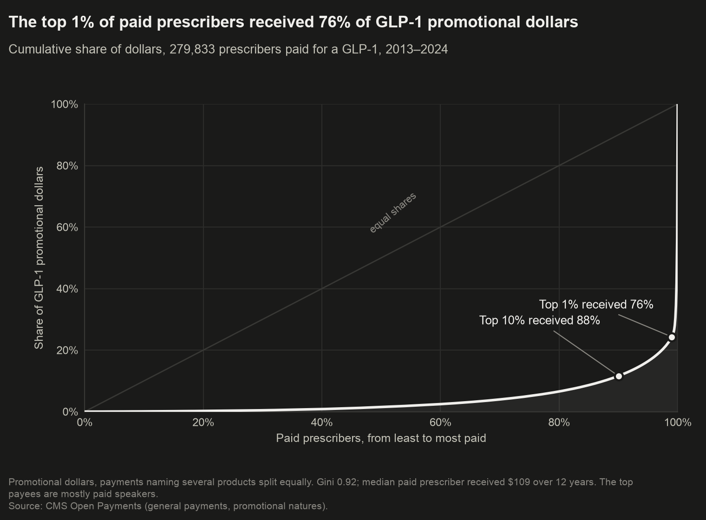{.dark-content .d-only fig-alt=""}
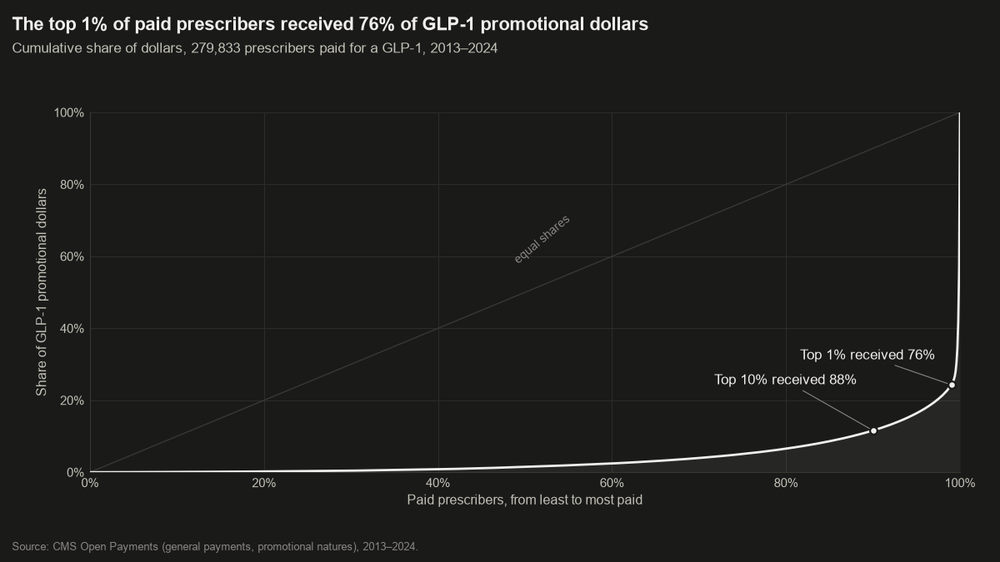{.dark-content .m-only fig-alt=""}
:::

GLP-1 promotional money is extremely concentrated. Of  prescribers paid for a GLP-1 from 2013 to 2024 ($ million in all), the top 1% received % of the dollars and the top 10% received % (Gini ); the median paid prescriber received $ over twelve years. Speaker and consulting fees are % of all GLP-1 promotional dollars, paid to  speakers in all; meals are %. These totals include payments naming the obesity drugs Wegovy, Saxenda and Zepbound (% of the dollars).

::: {.column-page-right}
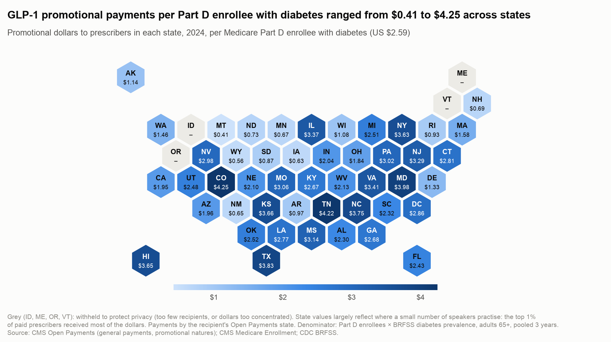{.light-content .d-only fig-alt=""}
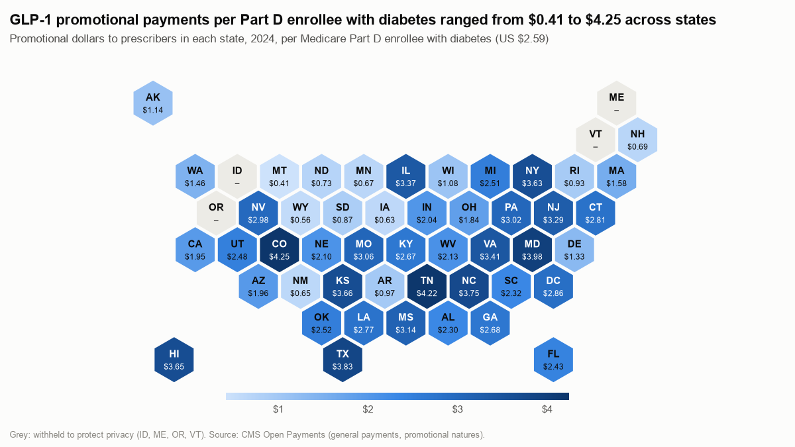{.light-content .m-only fig-alt=""}
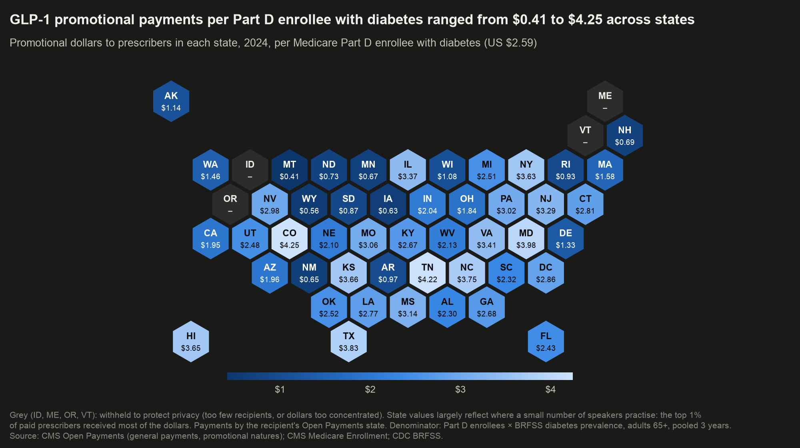{.dark-content .d-only fig-alt=""}
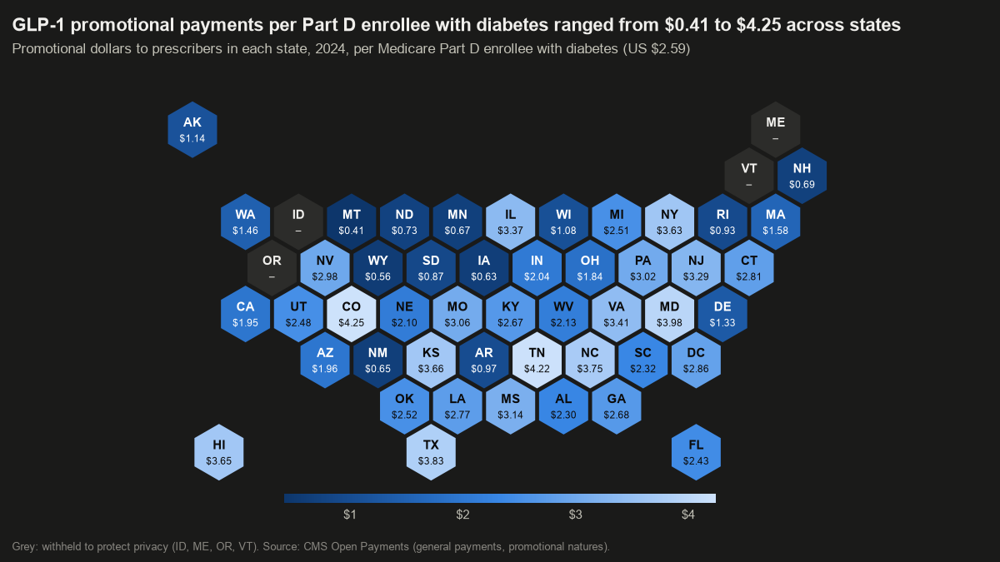{.dark-content .m-only fig-alt=""}
:::

Per Medicare Part D enrollee with diabetes, GLP-1 promotional payments in 2024 ranged from $ to $ across the states shown, against $ nationally. Because the money is so concentrated, state values largely reflect where a small number of speakers practise, not what a typical doctor there receives.  are withheld to protect privacy. To look up payments and prescribing for one specialty and state, brand by brand, use the [companion explorer](app/).

Relative to diabetes workload, endocrinologists receive about  times as much per claim as primary-care physicians ($ vs $ per 1,000 other diabetes-drug claims in 2024), consistent with speakers being concentrated among specialists.

## Who responds

The pre-registered secondary questions, each adjusted together for multiple testing [@holm1979]:

::: {.table-scroll}
| Question | Estimate | Holm-adjusted p | Reading |
|---|---|---|---|
| Speaker or consulting fee vs meals only |  pp |  | Not supported: too few fee recipients |
| Specialists vs primary care |  pp |  | Not supported |
| First-year $100 or more vs under $100 |  pp |  | Gradient; higher-paid doctors are more selected |
| Paid brand's share (log-odds, matched) |  pp |  | Supported, pooled; rests on matching and on how hidden counts are treated |
| 30-day fills (matched, hidden cells at their cap) | % |  | Volume rises, but much of it matches overall practice growth (% in total claims); % to % depending on how hidden cells are bounded |
| Nurse practitioners and physician assistants |  pp |  | Supported, with the same targeting caveat; payments reported only from 2021, no matched version |

: Secondary hypotheses. Data: [secondary_family.csv](qa/secondary_family.csv). {tbl-colwidths="[30,13,13,44]"}
:::

Subgroup estimates by region, rural or urban setting and specialty, which inherit the same targeting caveat, are in the [results log](https://github.com/johnpospisil/pharma-payments-glp1/blob/main/docs/results.md) with the specialty payment chart.

## Falsification and robustness

::: {.table-scroll}
| Test | What would sink the finding | Result |
|---|---|---|
| Pre-payment trend, ≥ 11 claims | Paid doctors already rising | **Fails**: steep rising trend for all three brands |
| Pre-payment trend, brand share | Share already rising | **Mixed**: passes for Trulicity unmatched (p = ) but fails matched (p = ); drift for Ozempic; fails for Victoza; weak for Mounjaro |
| Hidden small counts, brand share | Gain is a suppression artefact | **Shrinks** to  /  /  pp under the least favourable bound (Trulicity / Ozempic / Mounjaro) |
| Statins (negative-control outcome) | Statins rise too | **Fails** for all three:  /  /  pp |
| Anticoagulant payments (negative-control exposure) | Unrelated payments predict GLP-1 prescribing as strongly | **Passes** the registered rule, but unrelated payments still predict % of the association with any GLP-1 prescribing |
| Inhaled-respiratory payments (second negative-control exposure) | Same | **Fails** (%); AstraZeneca and GSK also sell GLP-1s |
| Fake payment dates one or two years early | "Effects" before the real payment | **Passes** the registered rule (small relative to the estimate), though fake dates still give up to  pp |
| Ozempic payment → Trulicity prescribing (placebo brand) | Competitor rises too | **Fails** in levels ( pp), but Trulicity's *share* falls |
| HonestDiD sensitivity | Small violations of parallel trends erase it | Survives trend breaks up to × / × / × the largest year-to-year pre-period change; if the pre-trend simply continued, about half remains |
|  alternative specifications | Effect depends on choices | Stays positive and above the 2-point threshold in all:  /  /  pp |

: Falsification and robustness for Trulicity / Victoza / Ozempic unless noted. The last two rows test how stable the ≥ 11-claims association is; they do not show that payments cause it. Fake dates can pass while trends rise because they are compared with not-yet-paid doctors on the same rising path. Data: [falsification.csv](qa/falsification.csv), [sensitivity.csv](qa/sensitivity.csv), [review_p24.json](qa/review_p24.json). {tbl-colwidths="[28,28,44]"}
:::

The failures mostly point the same way: paid doctors run larger and faster-growing practices. They undermine the volume result, which is why it is reported as targeting. They leave the direction of the brand-share result standing, but its size is small once the hidden counts are taken seriously.

## Limitations

- **Targeting is not ruled out, only partly removed.** Matching balances prior brand prescribing but not overall practice growth; matched paid doctors' practices grow even faster relative to their comparisons than unmatched ones, and the statin test fails even when matched on growth. Brand share removes practice size, but not earlier adoption of new brands, or visits timed to label changes (Victoza 2017, Ozempic and Trulicity 2020), formulary wins or the 2022–2024 shortages, which could raise a brand's share without the payment doing anything.
- **The share result is modest and model-dependent.** It is precise under the linear estimators but imprecise under the pre-registered log-odds form, where only Mounjaro is clear on its own, and it shrinks below the 2-point threshold under the least favourable treatment of hidden counts.
- **Annual data blur timing.** Payments arrive during the year, so the payment year is partly before and partly after.
- **Claims are not patients.** A claim is a pharmacy fill; dose-step fills for a newly started brand add claims without adding patients. Counting 30-day fills instead gives the same share result.
- **Who is studied.** Medicare Part D only (not commercial insurance or Medicaid); physicians first reached mostly by sponsored meals; nurse practitioners and physician assistants only from 2021. Medicare price negotiation for semaglutide (prices from 2027) and the 2025 kidney indication for Ozempic come after these data.
- **Spillovers.** Payments to one doctor may change colleagues' prescribing [@agha2022; @hyman2025]. Comparison doctors in practices where nobody was paid give *larger* estimates, consistent with spillovers biasing the main estimate down, though those practices also differ in other ways.

## Ethics: why no individual doctors appear

Open Payments names every recipient, and it would be easy to publish a league table. This project deliberately does not. A payment is legal, most are a sponsored meal worth tens of dollars, and a doctor who prescribes a paid brand may be prescribing well; a ranking would invite conclusions about individuals that aggregate data cannot support. Payment records are reported by companies and were not checked with the doctors. Every published figure and table aggregates at least 11 prescribers per cell, and cells are also withheld when one prescriber received more than half of the dollars, or when a hidden value could be worked out from the published totals. Code uses prescriber identifiers internally; nothing released contains them.

## Reproducibility

All data are public. The pipeline (Python 3.12, DuckDB; R only for cross-checking the estimators) rebuilds every number and figure from the raw federal files with one command, `make all`, in about two hours. Two independent rebuilds produce identical results. Every number in this article is read from the pipeline's QA outputs, never typed by hand, and a test fails if one is. Code, pre-registration, deviations and the QA report: [github.com/johnpospisil/pharma-payments-glp1](https://github.com/johnpospisil/pharma-payments-glp1).

**What is new here.** Earlier work, including the closest design [@carey2021], established that payments and prescribing go together, mostly from cross-sectional snapshots of older drugs. This project follows Medicare GLP-1 prescribers brand by brand over twelve years with estimators built for staggered timing, tests brand switching directly, and reports the negative controls and suppression bounds that cut against its own headline.

## References

::: {#refs}
:::
